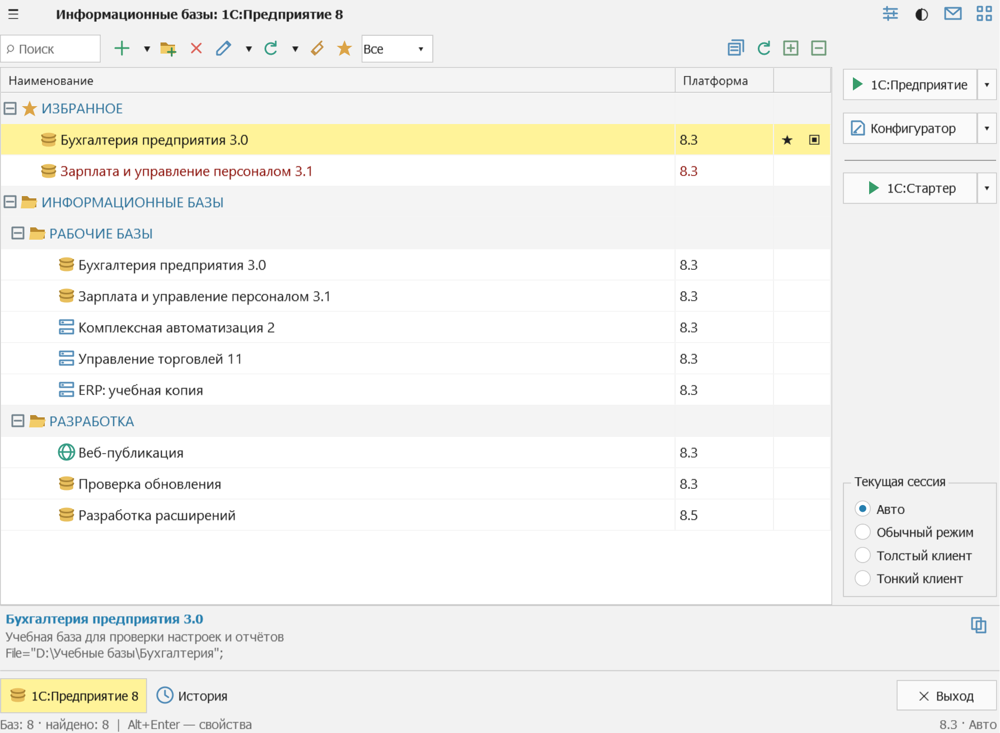
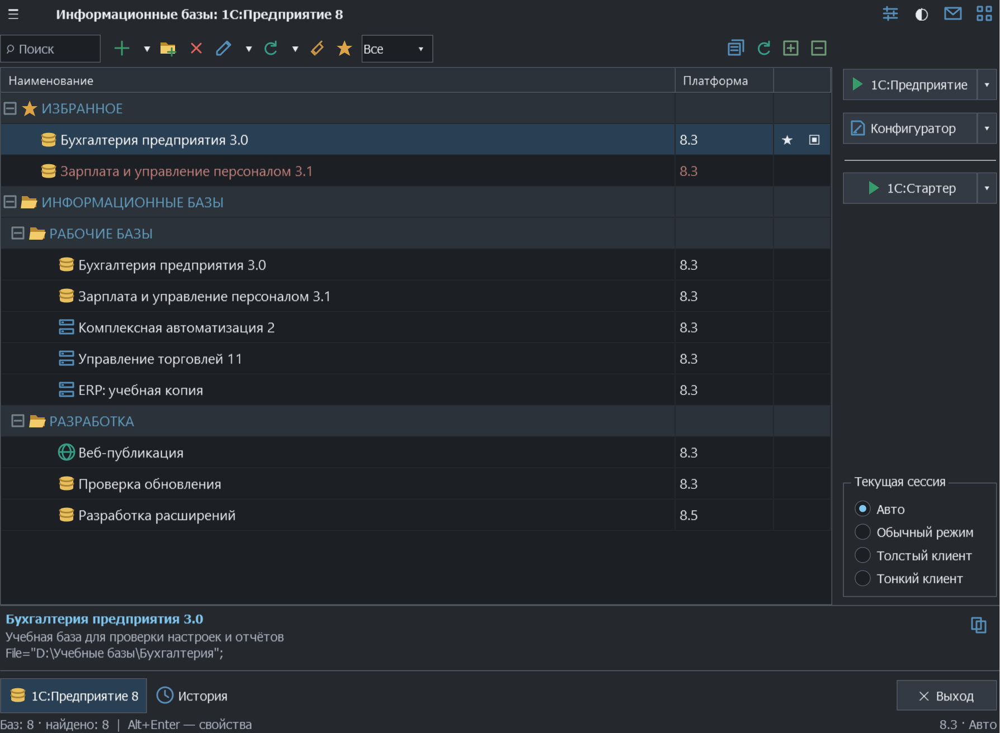
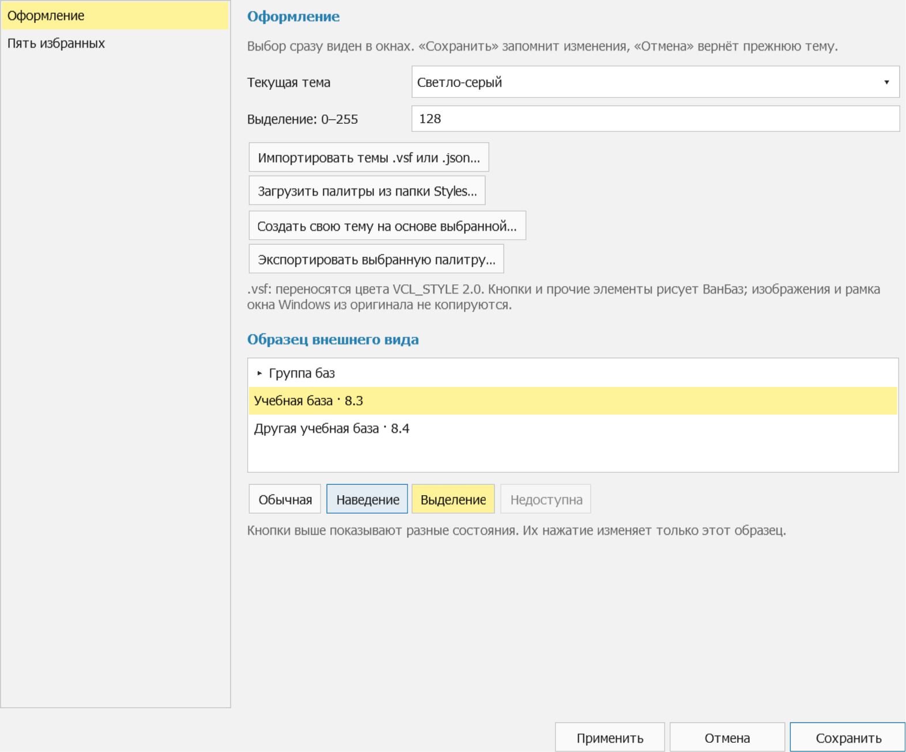

# ВанБаз (VanBaz)

ВанБаз помогает работать со списком баз 1С: запускать Предприятие и Конфигуратор, выбирать платформу, хранить параметры запуска и раскладывать базы по группам.

Это идейное продолжение [StartManager 1.4](https://infostart.ru/1c/tools/274485/) автора Alexoniq. Интерфейс максимально приближен к версии 1.4.0.155: сохранены привычная компоновка, меню и действия кнопок. Весь функционал написан с нуля на C#, .NET 8 и WPF. Проект независимый и не связан с авторами StartManager или фирмой «1С». Внутренние алгоритмы двух программ могут различаться.

## Скачать и запустить

[Скачать ВанБаз 0.21.0 для Windows x64](https://github.com/andrei-karpov/VanBaz/releases/download/v0.21.0/VanBaz-0.21.0-win-x64-portable.zip) · [Все релизы](https://github.com/andrei-karpov/VanBaz/releases)

Для запуска нужен **[.NET Desktop Runtime 8 для Windows x64](https://dotnet.microsoft.com/ru-ru/download/dotnet/8.0)**. На странице Microsoft выберите раздел «Среда выполнения рабочего стола .NET», затем установщик Windows x64. Если эта среда уже установлена, повторная установка не нужна.

Распакуйте ZIP целиком в папку, где разрешена запись, и запустите `VanBaz.exe`. Сам ВанБаз работает без установки; .NET в архив не входит. Платформу 1С и внешние утилиты нужно установить отдельно. Не запускайте EXE прямо из окна архиватора.

Чтобы обновиться, закройте ВанБаз и распакуйте новый ZIP в папку программы с заменой файлов. Папку `Data` сохраните: там находятся список баз и ваши настройки.

Если вы уже распаковали прежний архив со встроенным .NET, распакуйте компактную сборку в новую папку и перенесите туда свою папку `Data`. Так файлы старой среды выполнения не останутся рядом с программой. Если пользуетесь ярлыком, укажите в нём новый путь к `VanBaz.exe`.

## Интерфейс

На снимках используются вымышленные учебные базы. Сами примеры в приложение не включены.







## Что умеет ВанБаз

- Ведёт файловые и серверные базы, а также веб-публикации. Есть вложенные группы, поиск, отбор по платформе, избранное, заметки и история запусков.
- Читает штатный `ibases.v8i` и общие списки `CommonInfoBases`, обновляет их по F5, импортирует, экспортирует и сравнивает списки `.v8i`. Изменения личных регистраций записывает в штатный список. Подключения из общих источников доступны только для чтения.
- Запускает Предприятие и Конфигуратор с выбранной версией и разрядностью платформы. Можно закрепить EXE, сохранить профиль запуска, выбрать параметры из примеров или добавить внешнюю команду. Веб-публикации доступны через тонкий клиент с отдельными настройками HTTP и прокси либо через внешний браузер. Есть выбор способа подключения и предупреждение о повторном запуске процесса, ранее открытого через ВанБаз.
- Создаёт файловые и серверные базы через установленную платформу 1С. Поддерживает пустую базу, файл CF и выбор установленного шаблона; регистрацию существующей базы выполняет отдельно.
- Переносит из StartManager базы, группы и поддерживаемые настройки. Показывает отчёт о переносе и не меняет файлы оригинала. Пароли StartManager не импортирует.
- Позволяет настроить шрифт, высоту строк, колонки, цвета платформ и групп. Есть светлые и тёмные темы, собственная палитра, избранные стили и предварительный просмотр. Палитры можно импортировать и экспортировать; из поддерживаемых файлов `.vsf` переносятся цвета, без графики оригинальных скинов.
- Работает в режимах «Пользователь», «Специалист» и «Разработчик». Есть контекстные меню, быстрые кнопки, подсказки, горячие клавиши, значок в трее, ярлыки баз, автозапуск и команды Проводника для `.1CD`. Положение окна и поведение после запуска базы запоминаются.
- Помогает обслуживать кэш нескольких профилей Windows с отбором по Local/Roaming, версии и базам. Выборочная очистка переносит в карантин известные временные файлы, грубая — выбранные каталоги кэша целиком. Есть возврат из карантина, проверка файловой базы через `chdbfl` и операции с конфигурацией через установленную платформу. Прерванные действия можно разобрать в журнале восстановления.
- Находит платформы, открывает серверную консоль, показывает службы 1С и план их изменения. Регистрация COM и изменение существующих служб выполняются только по команде пользователя с подтверждением и повышением прав.
- Проверяет релиз выбранной базы по HTTPS или локальному UpdInfo.txt, показывает исходные версии обновления и открывает список дистрибутивов. ВанБаз можно обновить из ZIP в Releases или через настроенный канал с проверкой состава и SHA-256; сохранённую версию можно выбрать для ручного возврата. Автозагрузка необязательна, отсчёт можно отменить.
- Сохраняет каталог атомарно, делает снимки списка и настроек с заданным интервалом при запуске, восстанавливает их и создаёт переносимую копию приложения. В такую копию по выбору можно включить свой каталог. Замену путей и форматирование имён можно выполнить в текущем каталоге или отдельном `.v8i` с предварительным просмотром.
- Поддерживает 1С 7.7 при включении соответствующей настройки: список и запуск баз, импорт и экспорт регистраций, сортировку, очистку и восстановление индексов CDX.

## Где лежат данные

При первом запуске рядом с `VanBaz.exe` создаётся папка `Data`. В файле `catalog.json` хранятся локальные свойства баз, избранное, история, темы и настройки. Другую папку можно указать явно:

```powershell
.\VanBaz.exe --data-dir 'D:\VanBazData'
```

При обычном запуске программа также читает штатные списки 1С текущего пользователя. По умолчанию удаляется только регистрация. В окне удаления можно отдельно выбрать перенос файла базы и кэша в карантин; оба флага изначально выключены.

Сохранённые секреты защищены Windows DPAPI и доступны только исходной учётной записи Windows. Копирование папки программы на другой компьютер не переносит сами информационные базы и не меняет их адреса.

## Что учитывать

Снимки ВанБаз сохраняют каталог и настройки, но не содержимое информационных баз. Резервные копии самих баз нужно делать средствами 1С. Snegopat в проект не входит.

Проверка версии серверного агента определяет работающий локальный агент. Для удалённого или неоднозначного подключения программа сообщает, что версия не установлена. Создание службы выполняется установщиком 1С. Повторный запуск отслеживается по процессам, записанным ВанБаз; произвольные сеансы 1С программа не обнаруживает.

Внешний вид основан на WPF и собственных значках. Палитры и компоновка приближены к StartManager, но отдельные формы, системные диалоги и графика тем отличаются. Описание изменений конфигурации не извлекается из UpdInfo.txt; если метаданные не подтверждают возможность прямого обновления, ВанБаз не считает её установленной.

Автоматические проверки запуска используют тестовый EXE. Работу с настоящей платформой, внешними утилитами и сервером обновлений проверяйте на отдельной копии базы в своём окружении. Режимы интерфейса и временная блокировка окна не заменяют права доступа Windows и 1С. SHA-256 подтверждает целостность файла, но не подлинность его автора.

## Сборка из исходников

Для сборки нужны Windows и .NET SDK 8 с поддержкой Windows Desktop.

```powershell
git clone https://github.com/andrei-karpov/VanBaz.git
cd VanBaz
.\build.ps1
.\app\VanBaz.exe
```

Обычная сборка требует .NET Desktop Runtime 8 на компьютере, где её запускают. Команда `.\build.ps1 -Smoke` запускает общий набор проверок с временными каталогами и тестовым процессом вместо настоящей базы.

Компактный портативный ZIP без .NET:

```powershell
.\publish-portable.ps1
```

Архив и файл SHA-256 появятся в `packages`. В ZIP входят программа и инструкция со ссылкой на .NET Desktop Runtime 8. Пользовательские данные и учебные примеры в архив не попадают. Скрипт `package.ps1` собирает пакет для канала обновлений.

Код приложения находится в `src/VanBaz`, проверки и подготовка снимков интерфейса в `tests/Smoke`, генератор собственной иконки в `tools`. Пользовательские каталоги и локальные материалы исследования не публикуются.
